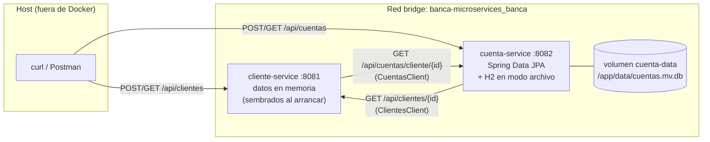

# Entrega 1 — Evidencias paso a paso

| | |
|---|---|
| **Proyecto** | Dos microservicios Java 21 + Spring Boot 4 en Docker comunicados por REST |
| **Repositorio** | https://github.com/Erimtz/banca-microservices |
| **Fecha de la ejecución** | 13 de noviembre de 2026 |
| **Contenedores** | `cliente-service` (:8081) y `cuenta-service` (:8082) |

Este documento recoge la ejecución real, paso a paso, de toda la entrega: levantamiento
de los dos contenedores, pruebas unitarias, **petición real de guardar y leer un dato
con ida y vuelta entre los dos contenedores**, persistencia con volumen y pipeline de CI.

| Observación recibida | Evidencia en este documento |
|---|---|
| Segundo servicio: configurar con variables de entorno y un volumen si guarda datos | Secciones 3, 4 y 5 (`.env.example`, H2 en `/app/data`, volumen `cuenta-data`) |
| Comunicación: falta demostrar una petición real de ida y vuelta (curl, guardar y leer) | **Sección 7** |
| Buenas prácticas: falta `.env.example` sin valores reales | Sección 4 |
| CI: falta un workflow de GitHub Actions que construya las imágenes | Sección 8 |
| Documento: faltan evidencias paso a paso, diagrama, conclusiones y referencias | Secciones 2, 6, 9 y 10 |

---

## 1. Prerrequisitos

- Docker Desktop con `docker compose` v2
- Java 21 y Maven 3.9 (solo para correr los tests sin Docker)
- `curl` y `jq` (para reproducir las pruebas de la sección 7)

---

## 2. Arquitectura



La comunicación entre los dos contenedores es **bidireccional y síncrona por REST**:

| Sentido | Endpoint propio | Endpoint consumido | Cliente HTTP |
|---|---|---|---|
| `cliente-service` → `cuenta-service` | `GET /api/clientes/{id}/cuentas` | `GET /api/cuentas/cliente/{clienteId}` | `CuentasClient` |
| `cuenta-service` → `cliente-service` | `GET /api/cuentas/{id}/titular` | `GET /api/clientes/{id}` | `ClientesClient` |

Cada servicio llama al otro **por el nombre del servicio dentro de la red de Docker**
(`http://cuenta-service:8082`, `http://cliente-service:8081`), no por `localhost`.

**Persistencia:** `cuenta-service` guarda en **H2 en modo archivo** dentro de
`/app/data`, cubierto por el volumen Docker `cuenta-data`, por lo que los datos
sobreviven a `restart` y a `docker compose down` (mientras no se use `down -v`).
`cliente-service` mantiene sus datos en memoria (se siembran en cada arranque), de modo
que el sistema sigue siendo **exactamente dos contenedores**.

---

## 3. Levantar los dos contenedores

```bash
git clone https://github.com/Erimtz/banca-microservices.git
cd banca-microservices
docker compose up -d --build
```

Salida real:

```
 cliente-service  Built
 cuenta-service  Built
 Container cuenta-service  Starting
 Container cuenta-service  Started
 Container cliente-service  Starting
 Container cliente-service  Started
```

Estado después de los healthchecks:

```bash
docker compose ps --format "{{.Name}} | {{.Status}} | {{.Ports}}"
```

```
cliente-service | Up (healthy) | 0.0.0.0:8081->8081/tcp
cuenta-service  | Up (healthy) | 0.0.0.0:8082->8082/tcp
```

El healthcheck de cada contenedor es un `curl` real contra su propio
`/actuator/health` (definido en `docker-compose.yml` y también como `HEALTHCHECK`
en cada Dockerfile).

---

## 4. Variables de entorno (`.env.example`)

El repo incluye **`.env.example`** con todas las variables del proyecto y sus
descripciones, **sin secretos ni valores sensibles**. El archivo real `.env` está en
`.gitignore` y nunca se sube.

```bash
cp .env.example .env    # opcional: docker compose usa los valores por defecto
docker compose up -d
```

En `docker-compose.yml` cada variable se referencia con valor por defecto, por ejemplo:

```yaml
SERVICIO_CLIENTES_BASE_URL: ${SERVICIO_CLIENTES_BASE_URL:-http://cliente-service:8081}
CUENTA_DB_URL: ${CUENTA_DB_URL:-jdbc:h2:file:/app/data/cuentas}
```

Las variables cubiertas (ver el archivo completo):

| Variable | Propósito |
|---|---|
| `SERVICIO_CUENTAS_BASE_URL` / `SERVICIO_CLIENTES_BASE_URL` | URL del microservicio remoto dentro de la red |
| `SERVICIO_CUENTAS_TIMEOUT_MS` / `SERVICIO_CLIENTES_TIMEOUT_MS` | Timeout de las llamadas salientes |
| `SERVICIO_NOMBRE_CLIENTE` / `SERVICIO_NOMBRE_CUENTA` | Nombre que aparece en los logs |
| `CUENTA_DB_URL` / `CUENTA_DB_USER` / `CUENTA_DB_PASSWORD` | Conexión de H2 dentro del contenedor |

---

## 5. Persistencia del segundo servicio (H2 + volumen)

`cuenta-service` usa **Spring Data JPA + H2 en modo archivo**. En el primer arranado
Hibernate crea el esquema (`ddl-auto: update`) y `DatosSemilla` inserta las 4 cuentas
de ejemplo **solo si la tabla está vacía**; en los arranques siguientes conserva lo
que haya.

Verificación del archivo dentro del volumen:

```bash
docker compose exec cuenta-service ls -la /app/data
```

```
total 32
drwxr-xr-x 2 app app  4096 Nov 13 17:06 .
drwxr-xr-x 1 app app  4096 Nov 13 17:05 ..
-rw-r--r-- 1 app app 24576 Nov 13 17:06 cuentas.mv.db
```

Datos sembrados en la primera pasada:

```bash
curl -s http://localhost:8082/api/cuentas
```

```json
[{"id":1,"numero":"4750123456","tipo":"AHORRO","saldo":1500000.00,"clienteId":1},
 {"id":2,"numero":"4750654321","tipo":"CORRIENTE","saldo":320000.50,"clienteId":1},
 {"id":3,"numero":"4750112233","tipo":"AHORRO","saldo":890000.00,"clienteId":2},
 {"id":4,"numero":"4750998877","tipo":"DEPOSITO","saldo":5400000.00,"clienteId":3}]
```

El volumen queda declarado en `docker-compose.yml`:

```yaml
volumes:
  cuenta-data:          # guarda /app/data/cuentas.mv.db
```

---

## 6. Pruebas unitarias

```bash
cd cliente-service && mvn test
```

```
[INFO] Tests run: 15, Failures: 0, Errors: 0, Skipped: 0
[INFO] BUILD SUCCESS
```

```bash
cd cuenta-service && mvn test
```

```
[INFO] Tests run: 16, Failures: 0, Errors: 0, Skipped: 0
[INFO] BUILD SUCCESS
```

Cobertura por nivel: casos de uso con Mockito, controladores con `@WebMvcTest` +
`MockMvc` y el contrato HTTP de cada cliente con `MockRestServiceServer`.

---

## 7. Evidencia: guardar y leer un dato con ida y vuelta entre contenedores

Esta es la prueba completa pedida: se **guarda** un dato en cada contenedor con `curl`
y luego se **lee** compuesto, de modo que cada microservicio tiene que hacer una
llamada HTTP real al otro para responder.

### 7.1 Guardar un cliente en el contenedor 1

```bash
curl -s -X POST http://localhost:8081/api/clientes \
  -H "Content-Type: application/json" \
  -d '{"nombre":"Evidencia Profesor","email":"evidencia@ejemplo.com","documento":"77777777"}'
```

```
HTTP 201 Created
{"id":4,"nombre":"Evidencia Profesor","email":"evidencia@ejemplo.com","documento":"77777777"}
```

### 7.2 Guardar una cuenta en el contenedor 2, referenciando ese cliente

```bash
curl -s -X POST http://localhost:8082/api/cuentas \
  -H "Content-Type: application/json" \
  -d '{"numero":"4750123123","tipo":"AHORRO","saldo":987654.32,"clienteId":4}'
```

```
HTTP 201 Created
{"id":5,"numero":"4750123123","tipo":"AHORRO","saldo":987654.32,"clienteId":4}
```

### 7.3 LEER — `cuenta-service` llama al `cliente-service` (ida y vuelta)

```bash
curl -s http://localhost:8082/api/cuentas/5/titular
```

```
HTTP 200 OK
{"cuenta":{"id":5,"numero":"4750123123","tipo":"AHORRO","saldo":987654.32,"clienteId":4},
 "titular":{"id":4,"nombre":"Evidencia Profesor","email":"evidencia@ejemplo.com","documento":"77777777"}}
```

El `cuenta-service` respondió con su dato local **y** con el titular que obtuvo
haciendo una petición HTTP al `cliente-service` en ese mismo momento.

### 7.4 LEER — `cliente-service` llama al `cuenta-service` (sentido contrario)

```bash
curl -s http://localhost:8081/api/clientes/4/cuentas
```

```
HTTP 200 OK
{"cliente":{"id":4,"nombre":"Evidencia Profesor","email":"evidencia@ejemplo.com","documento":"77777777"},
 "cuentas":[{"id":5,"numero":"4750123123","tipo":"AHORRO","saldo":987654.32,"clienteId":4}]}
```

Ahora el `cliente-service` devolvió su cliente local **más** la cuenta que acaba de
consultar al `cuenta-service`.

### 7.5 Los logs prueban la llamada HTTP cruzada real

```bash
docker compose logs cliente-service cuenta-service | grep -E "CuentasClient|ClientesClient"
```

```
cliente-service | c.e.p.b.cliente.client.CuentasClient  : [cliente-service] GET /api/cuentas/cliente/4 -> 1 cuenta(s)
cuenta-service  | c.e.p.b.cuenta.client.ClientesClient  : [cuenta-service]  GET /api/clientes/4 -> Evidencia Profesor
```

Cada línea corresponde a una petición HTTP **saliente de un contenedor hacia el otro**
por la red interna de Docker (no por `localhost`).

---

## 8. Evidencia: el volumen conserva el dato tras reiniciar

Se reinicia **solo** `cuenta-service` y se vuelve a leer la misma cuenta:

```bash
docker compose restart cuenta-service
# ... esperar a que el healthcheck vuelva a estar UP ...
curl -s http://localhost:8082/api/cuentas/5
```

```
HTTP 200 OK
{"id":5,"numero":"4750123123","tipo":"AHORRO","saldo":987654.32,"clienteId":4}
```

El dato **persiste**: el archivo `cuentas.mv.db` vive en el volumen
`banca-microservices_cuenta-data`:

```bash
docker volume ls | grep cuenta
```

```
banca-microservices_cuenta-data
```

Estado final:

```
cliente-service | Up (healthy)
cuenta-service  | Up (healthy)
```

> `docker compose down` **conserva** el volumen; solo `docker compose down -v` lo
> borra (eso está documentado en el README).

---

## 9. Evidencia: pipeline de CI (GitHub Actions)

El workflow [`.github/workflows/ci.yml`](../.github/workflows/ci.yml) se ejecuta en
cada `push` a `main` y en cada Pull Request, con dos jobs:

**Job 1 — `test`** (matriz sobre los dos servicios):

```yaml
- name: mvn test
  working-directory: ${{ matrix.service }}
  run: mvn -B -ntp test
```

**Job 2 — `build-and-e2e`** (construye las imágenes y prueba la ida y vuelta):

1. `docker compose up -d --build` → **construye las imágenes** de ambos servicios.
2. Espera a que los dos healthchecks respondan `UP`.
3. **Guarda** un cliente (`POST /api/clientes`) y una cuenta (`POST /api/cuentas`)
   con `curl` + `jq`.
4. **Lee** `GET /api/cuentas/{id}/titular` y `GET /api/clientes/{id}/cuentas`
   verificando con `jq` que la respuesta compuesta es correcta.
5. Revisa en los logs que se registró la llamada cruzada.
6. Reinicia `cuenta-service` y verifica que el dato **persistió** en el volumen.
7. Muestra `docker compose ps`, `docker volume ls` y los logs al finalizar
   (incluso si algo falla) y limpia con `docker compose down -v`.

Estado del pipeline: ver el badge en el [README](../README.md) y la pestaña
*Actions* del repositorio.

---

## 10. Conclusiones

1. **Comunicación bidireccional demostrada.** Las secciones 7.3 y 7.4 muestran una
   petición real en los dos sentidos: cada contenedor expone un endpoint propio que
   consume al otro por HTTP dentro de la red de Docker, y los logs registran la
   llamada saliente correspondiente.
2. **El segundo servicio ahora persiste sus datos.** `cuenta-service` pasó de un
   `ConcurrentHashMap` a Spring Data JPA + H2 en modo archivo, respaldado por el
   volumen `cuenta-data`; la sección 8 demuestra que el dato sobrevive a un reinicio.
3. **Configuración por variables de entorno.** Todas las URLs, timeouts y parámetros
   de la base están en `.env.example` con valores por defecto dentro de `docker-compose.yml`
   (`${VAR:-default}`); `.env` (con valores reales) está excluido del repo.
4. **CI integrado.** El workflow de GitHub Actions corre los 31 tests, construye las
   imágenes Docker y ejecuta la misma prueba de ida y vuelta con persistencia en cada
   push, de modo que la comunicación entre contenedores queda verificada automáticamente.
5. **Dos contenedores, sin servicios extra.** H2 corre embebido dentro del propio
   `cuenta-service` (no abre puertos externos), así que no se rompe el requisito de
   exactamente dos contenedores.
6. **Mejora posible a futuro:** migrar también `cliente-service` a persistencia con
   archivo/volumen para que ambos servicios tengan el mismo ciclo de vida.

---

## 11. Referencias

- Spring Boot — guía oficial: https://spring.io/projects/spring-boot
- Spring Data JPA (referencia): https://docs.spring.io/spring-data/jpa/reference/jpa/
- H2 Database — modo archivo: https://h2database.com/html/quickstart.html
- Jakarta Persistence (JPA): https://jakarta.ee/specifications/persistence/
- Docker Compose — volúmenes: https://docs.docker.com/compose/how-tos/persist-volumes/
- Docker Compose — variables de entorno: https://docs.docker.com/compose/how-tos/environment-variables/
- GitHub Actions — documentación: https://docs.github.com/en/actions
- Maven — guía de uso: https://maven.apache.org/guides/
- Spring RestClient: https://docs.spring.io/spring-framework/reference/web/webmvc.html#webmvc-restclient
- Colección Postman del proyecto: [`postman/README.md`](../postman/README.md)
